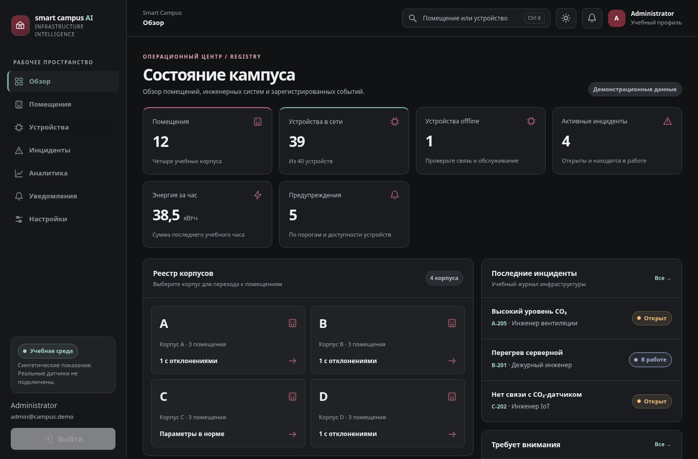
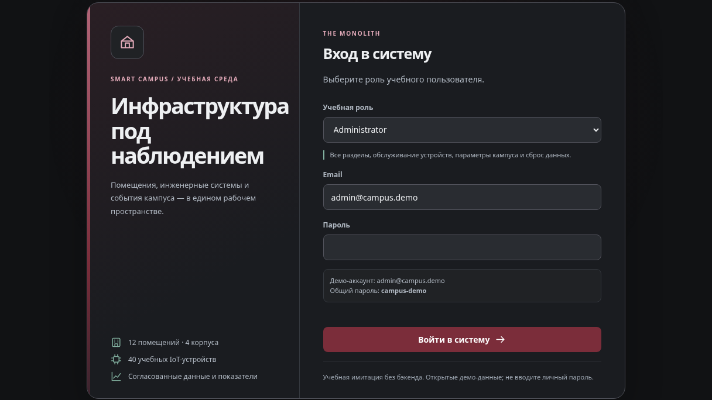
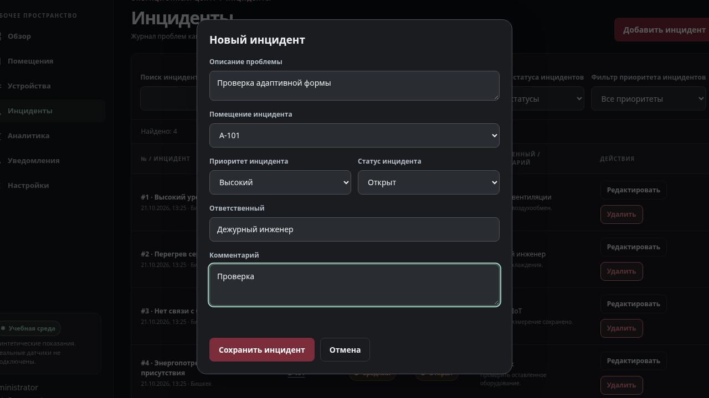
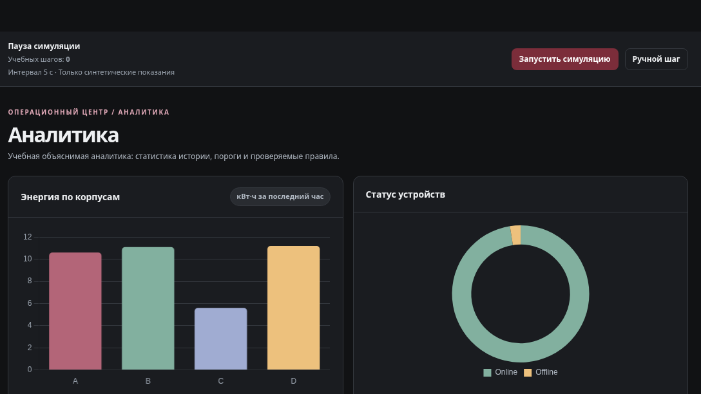
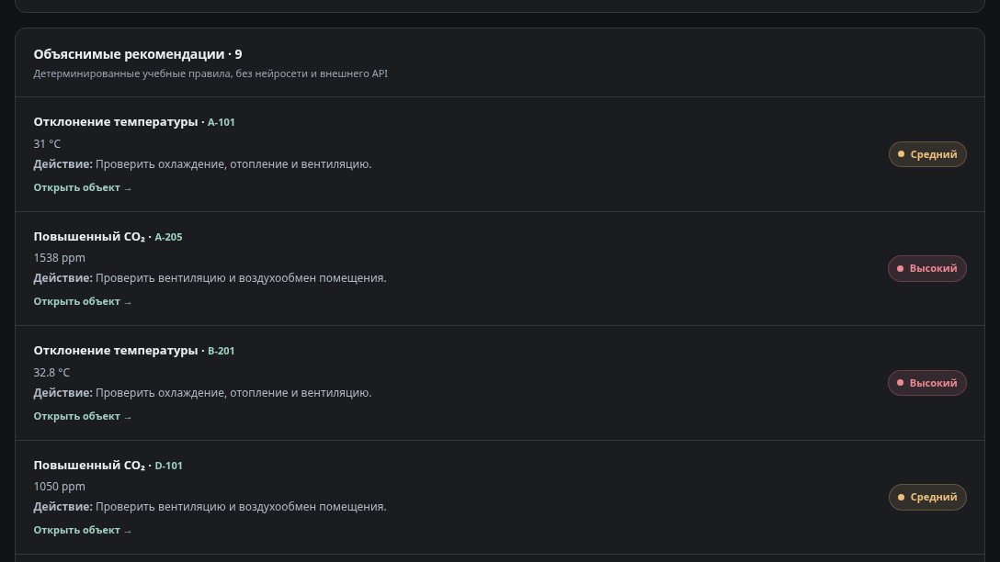
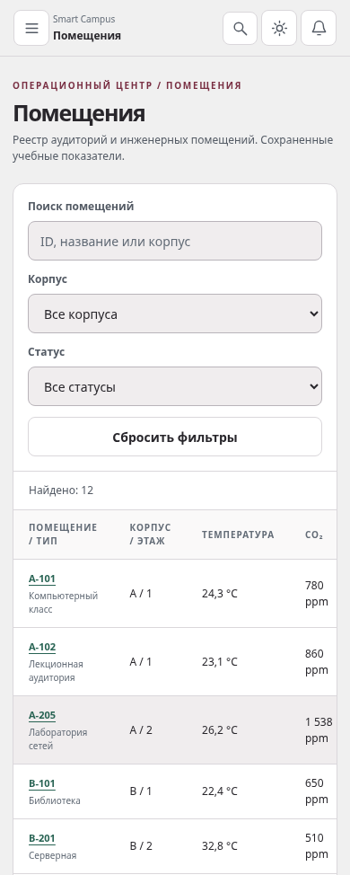
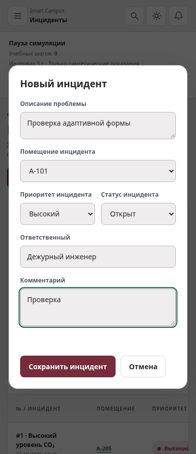

# Smart Campus AI

Учебная веб-платформа для мониторинга и управления инфраструктурой кампуса.
Помещения, IoT-устройства, инциденты и энергопотребление собраны в одном интерфейсе
с симуляцией показаний и объяснимым статистическим анализом.

<a href="assets/previews/readme-dashboard.png"></a>

*Dashboard: ключевые показатели, состояние корпусов и журнал событий. Все показания учебные.*

## Основные возможности

- **Обзор кампуса:** шесть динамических KPI, предупреждения и переходы к связанным объектам.
- **Помещения и устройства:** 12 помещений в четырёх корпусах, 40 IoT-устройств, поиск, фильтры и подробные карточки.
- **Инциденты:** создание, редактирование и удаление с валидацией полей, разграничением действий и подтверждением удаления.
- **Аналитика:** три графика Chart.js, обнаружение аномалий методом z-score, причины отклонений и рекомендации.
- **Уведомления и настройки:** активные предупреждения, индивидуальные отметки прочтения, параметры кампуса и сброс учебных данных.

Семь разделов приложения: **Dashboard, Rooms, Devices, Incidents, Analytics, Notifications, Settings**.
Светлая и тёмная темы, клавиатурная навигация и адаптивные таблицы доступны во всём приложении.

## Галерея интерфейса

**Garnet Ash × Mineral Steel** — графитовые поверхности, гранатовые и минерально-нефритовые акценты.
Экран входа — *The Monolith*, рабочее пространство — *The Registry*.
Изображения можно открыть в полном размере.

<p>
  <a href="assets/previews/readme-login.png"></a>
  <a href="assets/previews/readme-incident.png"></a>
</p>

**Авторизация** — компактная форма и выбор роли. **Инциденты** — описание проблемы, ответственный и управление статусом.

<p>
  <a href="assets/previews/readme-analytics.png"></a>
  <a href="assets/previews/readme-recommendations.png"></a>
</p>

**Аналитика** — энергия и доступность устройств. **Рекомендации** — конкретная причина, приоритет и предлагаемое действие.

### На мобильном экране

<p align="center">
  <a href="assets/previews/readme-rooms-mobile.png"></a>
  <a href="assets/previews/incident-form-stage2-light-390.png"></a>
</p>

**Помещения:** поиск и фильтры над реестром, из карточек доступны связанные устройства.
**Инциденты:** форма сохраняет доступность полей и действий на узком экране.
Вертикальные мобильные примеры показаны отдельно от десктопных превью.

## Учебная аналитика и симуляция

Физические пороги температуры, CO₂ и энергопотребления проверяются независимо
от статистических аномалий. Z-score показывает, насколько текущее измерение
отличается от предыдущих: `|z| = |(x − μ) / σ|`, порог обнаружения — `|z| > 2`.
Недостаточная история, нулевая дисперсия, offline и устаревшие данные обрабатываются отдельно.
Рекомендации связывают показание с действием: например, проверить вентиляцию при высоком CO₂
или питание недоступного датчика.

Симуляцией можно управлять: **запустить, поставить на паузу или выполнить ручной шаг**.
Обновления согласованы между помещениями, устройствами, KPI, графиками и уведомлениями.
Offline-датчики сохраняют последние значения; после перезагрузки симуляция остаётся на паузе.
Это учебные измерения и правила, а не подключение к реальному кампусу или обученная нейросеть.

## Демонстрационный вход и роли

Общий демонстрационный пароль: **`campus-demo`**.

- **Administrator** — `admin@campus.demo`. Полный CRUD инцидентов, симуляция, обслуживание устройств, настройки и сброс данных.
- **Engineer** — `engineer@campus.demo`. Создание и редактирование инцидентов, симуляция и обслуживание устройств.
- **Operator** — `operator@campus.demo`. Просмотр, поиск, фильтры и отметка уведомлений прочитанными.

Это клиентская имитация авторизации. Не используйте личные пароли; серверной защиты доступа нет.

## Команда проекта

**Машуров Артур Геннадьевич** — руководитель проекта и основной разработчик.
Концепция, архитектура, организация разработки, интеграция и запуск.

**Ермолаев Никита Александрович** — разработчик пользовательского интерфейса (Frontend).
Вёрстка, оформление компонентов и адаптивность.

**Каракашева Алина Таалайбековна** — тестировщик (QA).
Проверка функциональности, интерфейса и соответствия методическим требованиям.

**Группа:** КС-3-24. **Преподаватель:** Каныбеков Карель Каныбекович.

## Используемые технологии

- **HTML5 и CSS3** — семантическая разметка, адаптивность и две темы.
- **JavaScript, ES modules** — навигация, CRUD, симуляция и аналитика.
- **Chart.js 4.5.1** — графики; библиотека и её лицензия поставляются локально.
- **localStorage и sessionStorage** — учебные данные, настройки и демо-сеанс.
- **Node.js test runner и Playwright / Chromium** — автоматизированные проверки.

## Локальный запуск

Для просмотра достаточно Python 3.10+. В корне проекта выполните:

```sh
python -m http.server 8080 --bind 127.0.0.1
```

Откройте `http://127.0.0.1:8080/` в браузере.
Установка npm-пакетов для просмотра не нужна: Chart.js уже находится в `assets/vendor/`.
Открытие через `file://` не подходит — ES-модулям нужен HTTP-сервер.

## Проверка работоспособности

В ходе функциональной проверки проекта успешно пройдены **58 автоматизированных тестов**:
**36 модульных и 22 браузерных**. Проверены CRUD, роли, симуляция, сохранение данных,
z-score, рекомендации, согласованность экранов и графиков.
Адаптивность проверена при **1920, 1366, 768 и 390 px** в обеих темах.

Для полной подготовки и проверки в Linux нужны Node.js 22+, Python с venv и Chromium:

```sh
bash scripts/setup.sh
```

Chromium ожидается в `/usr/bin/chromium`; другой путь можно указать через `CHROMIUM_PATH`.
Повторный запуск проверок после подготовки:

```sh
npm run check
npm test
.venv/bin/python tests/browser.py
.venv/bin/python tests/browser_stage2.py
```

Браузерные сценарии проверяют приложение также в подкаталоге `/smart-campus-ai/`.
Успешные тесты не означают, что сайт уже опубликован.

## Структура исходников

```text
index.html          Вход и общая оболочка приложения
assets/
  css/              Дизайн-токены, компоненты и стили разделов
  js/               Модель данных, CRUD, симуляция, аналитика и представления
  vendor/           Chart.js и лицензия
  previews/         Исходные скриншоты и отдельные превью для README
tests/              Модульные и браузерные проверки
scripts/            Подготовка окружения и проверка исходников
```

## Ограничения учебной реализации

Данные синтетические; реальных IoT-подключений, бэкенда и серверной базы данных нет.
Состояние хранится в браузере без автоматической синхронизации вкладок.
Авторизация демонстрационная, аналитика статистическая и основана на правилах.
Публичный сайт GitHub Pages пока не опубликован: его размещение и публичная проверка выполняются отдельно.
